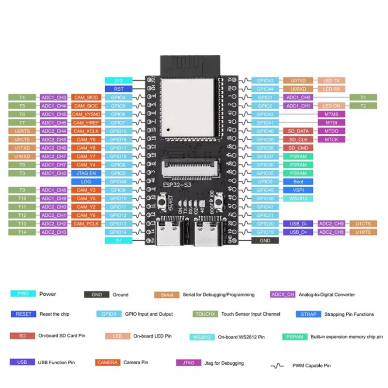

# Pinová mapa desky ESP32-S3 pro kufr

Tento přepis vychází z [obrázku dodaného pro projekt](pin-map-esp32-s3.png).
Prodejce popisuje vybranou desku jako ESP32-S3 N16R8 s konektorem OV5640,
slotem MicroSD a dvěma porty USB-C ([produktová stránka](https://dratek.cz/arduino-platforma/232701-vyvojova-deska-esp32-s3-s-konektorem-pro-kameru-ov5640-wifi-bluetooth.html)).
Obrázek ukazuje funkce vyvedených pinů; není to schéma zapojení externích
prvků kufru ani potvrzení skutečného osazení doručené revize desky.

Předběžné kompletní přidělení externích signálů je v kapitole 10
[implementačního plánu](implementacni-plan.md): profil A bez kamery/SD
a profil B s OV5640 + SD, MCP23017 a podmíněným sdílením LED pinů.
Tabulky jsou návrh do ověření desky, nikoli pokyn k okamžitému zapojení.
Výsledky měření a blokace se evidují ve [stavu implementace](stav-implementace.md).

## Doručený kus – první USB ověření 2. 10. 2026 (D122)

Fotografie majitele ukazují potisk N16R8, kamerový konektor a MicroSD;
spodní strana rozlišuje konektory `USB-UART` a `USB-OTG`. Připojený
USB-UART (VID 1A86/PID 55D3, COM7) umožnil ROM čtení, první autorizovaný
diagnostický flash a tři úspěšné EN/RTS restarty. Potvrzeno: ESP32-S3
revize čipu v0.2, 16 MB Quad flash/3,3 V a 8 MB Octal PSRAM na 80 MHz.
SDK startup test a čtení/zápis čtyř vzorů nad 7 MiB prošly; nejde o
hustý test všech 8 MiB. Revize PCB, elektrické vedení a funkce externích
GPIO, USB-OTG, LED, kamery a SD tím nejsou ověřené. Doklady a zbylé B1
podmínky jsou v [D122 stavu implementace](stav-implementace.md).

## Vazby vyznačené na obrázku

| Funkce | GPIO a signály |
| --- | --- |
| Konektor kamery | 4 SIOD, 5 SIOC, 6 VSYNC, 7 HREF, 8 Y4, 9 Y3, 10 Y5, 11 Y2, 12 Y6, 13 PCLK, 15 XCLK, 16 Y9, 17 Y8, 18 Y7 |
| Slot MicroSD | 38 CMD, 39 CLK, 40 DATA |
| PSRAM | 35, 36, 37 |
| Nativní USB | Obrázek uvádí 19 D+ a 20 D−; je v rozporu s dokumentací čipu, viz upozornění níže. |
| UART0 | 43 TX, 44 RX; obrázek u nich značí také LED TX/RX |
| LED na desce | 2 „LED ON“, 48 WS2812 |
| Boot a strapping | 0 BOOT, 3 JTAG_EN, 45, 46 LOG |
| JTAG | 39 MTCK, 40 MTDO, 41 MTDI, 42 MTMS; 39 a 40 jsou současně označené pro MicroSD |
| Napájení | piny 3V3, 5V a GND; 5V pin není určený jako napájecí rozvod pro serva a RGB |

**Rozpor USB:** [Espressif pro ESP32-S3](https://docs.espressif.com/projects/esp-idf/en/latest/esp32s3/api-guides/jtag-debugging/configure-builtin-jtag.html)
uvádí GPIO19 D− a GPIO20 D+. Předchozí textový přepis používal toto pořadí,
ale vydával ho za popisky obrázku. Obrázek neměnit ani podle něj opravovat
fyzické vedení; schéma/konektory konkrétní desky teprve ověřit. Nativní USB
19/20 zůstává rezervované v obou navržených profilech.

GPIO1, GPIO14, GPIO21 a GPIO47 nemají na obrázku vyznačenou vazbu na
kameru, MicroSD, PSRAM, USB ani LED. To samo o sobě neprokazuje, že jsou
na konkrétní osazené desce elektricky volné nebo vhodné pro libovolnou zátěž.

## Omezení pro návrh

- Kamera je od nákupního auditu 6. 10. 2026 zahrnutá do objednávky pro profil B;
  její konektor podle obrázku sdílí 14 GPIO. Funkce ještě není implementovaná
  ani ověřená. Externí zapojení musí počítat s těmito rezervovanými piny.
- MicroSD používá GPIO38–40; použití slotu a JTAG na GPIO39/40 se musí
  posoudit společně.
- U ESP32-S3 jsou GPIO0, GPIO3, GPIO45 a GPIO46 strapping piny. GPIO19/20
  slouží pro USB a piny GPIO33–37 mohou být obsazené Octal PSRAM/flash.
  Nevybírat je pro nové výstupy pouze podle toho, že jsou na liště desky.
  Podrobnosti uvádí [Espressif GPIO](https://docs.espressif.com/projects/esp-idf/en/latest/esp32s3/api-reference/peripherals/gpio.html)
  a [hardwarové pokyny ke strapping pinům](https://docs.espressif.com/projects/esp-hardware-design-guidelines/en/latest/esp32s3/schematic-checklist.html#strapping-pins).
- Předběžná přidělení RGB, PCA9685, audia, tlačítka a bezpečnostních signálů
  jsou v plánu. Šest U059 se řídí přes PCA kanály 6–11 digitálním FULL_ON/OFF,
  serva přes kanály 0–5; společnou servo frekvenci nelze vydávat za nezávislé
  PWM vibrací. Profil B vyžaduje ověření LED GPIO2/48 a uvolnění externího
  JTAG při zachování USB/debug; při nevyhovění plán porovnává druhý řadič.
  V současném firmware tyto piny **nejsou implementované ani ověřené**.
- Před pájením a nahráním firmwaru porovnat obrázek s potiskem a schématem
  skutečně dodané revize desky. Funkce 3V3/5V, PSRAM a USB ověřit na
  konkrétním kusu; současná konfigurace PlatformIO sama správné zapojení
  ani parametry pamětí nepotvrzuje.
